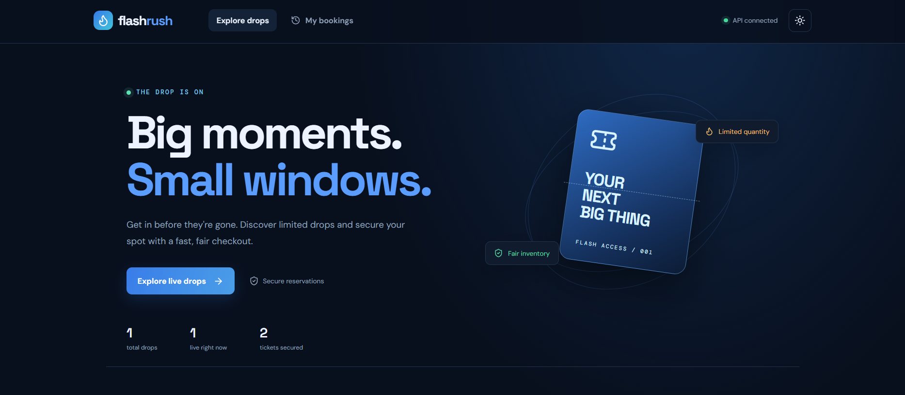
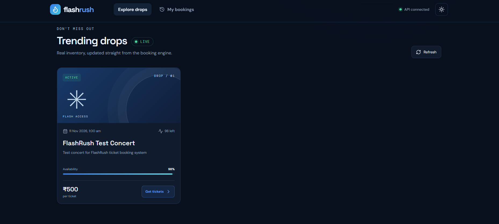
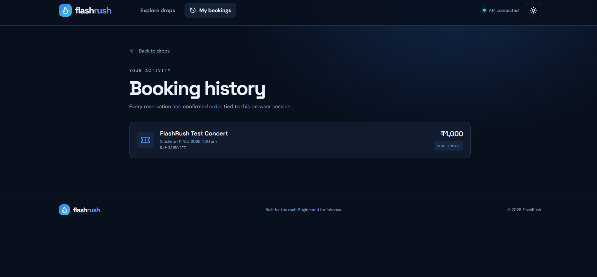
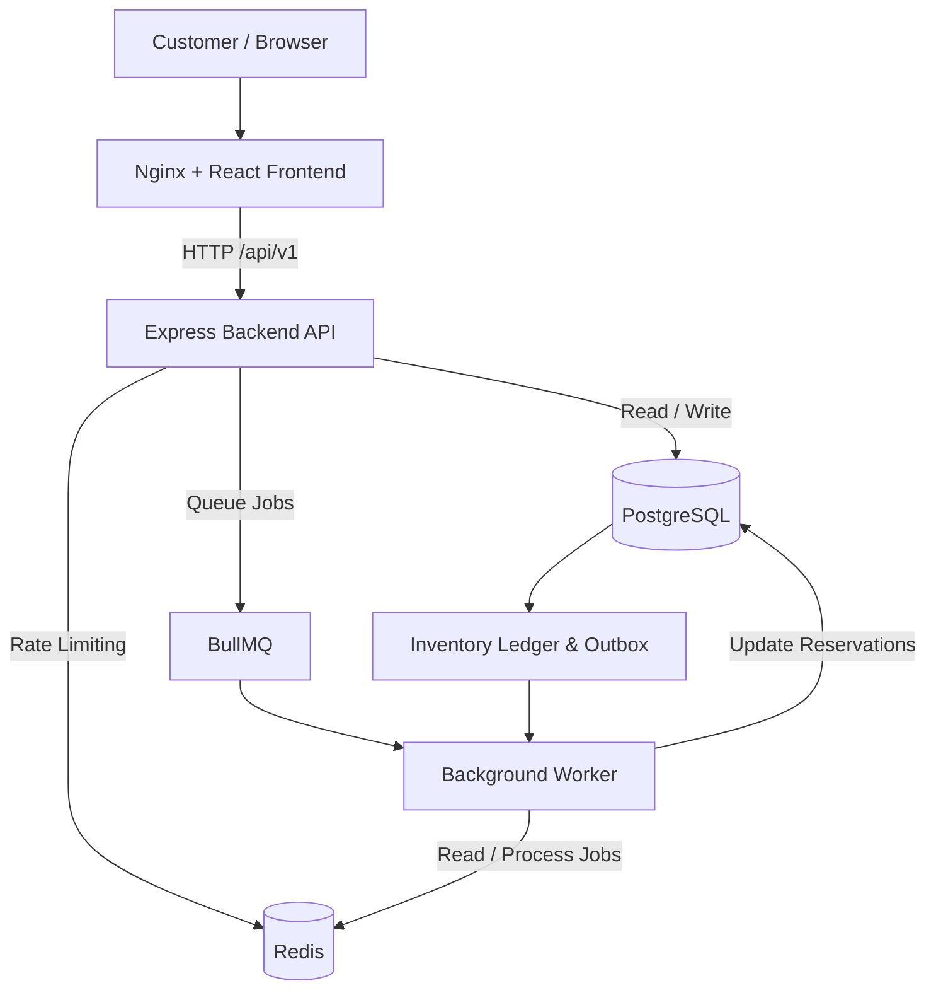
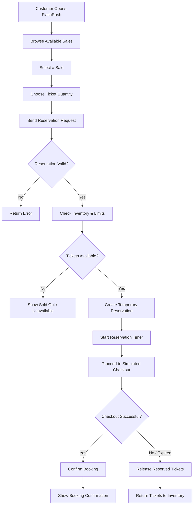
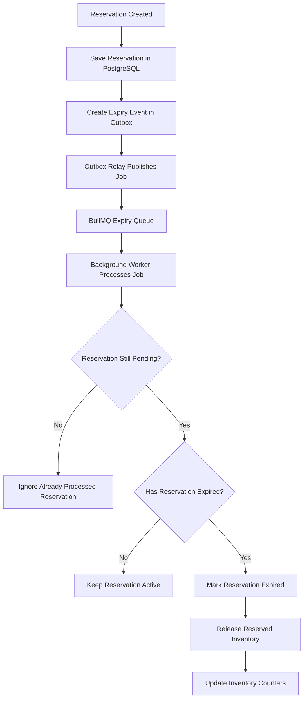
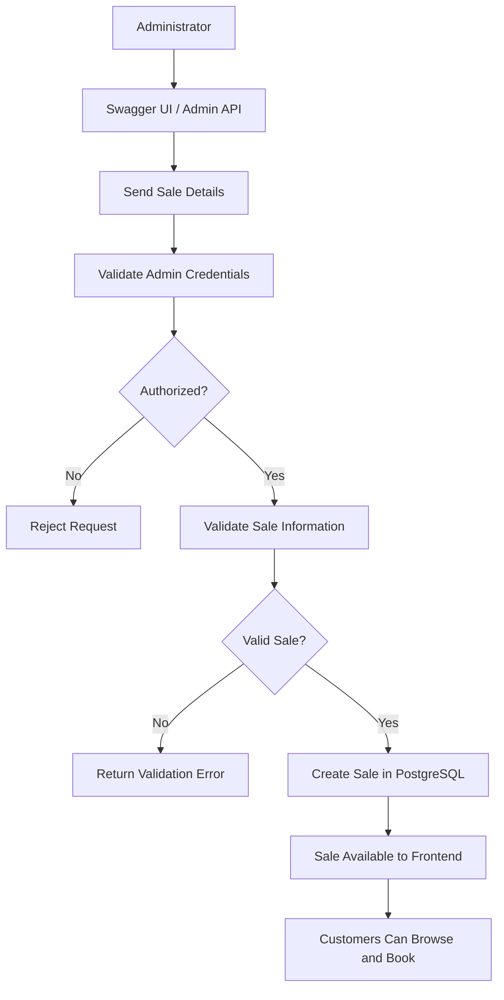

# FlashRush — Flash Sale & Ticket Booking Platform

A full-stack flash-sale and ticket reservation platform designed to handle limited-inventory events, concurrent booking requests, timed reservations, and secure checkout workflows.

FlashRush provides a responsive customer-facing storefront backed by a transactionally safe Node.js API. It uses PostgreSQL as the source of truth for ticket inventory, Redis for rate limiting and job processing, and BullMQ workers for reservation expiry.

The project focuses on backend reliability, inventory consistency, concurrency handling, and a clean customer booking experience.

---

## Screenshots

Here are some screenshots of the FlashRush application.

### 1. Home Page



### 2. Sale Details & Ticket Reservation



### 3. Booking Confirmation / Booking History



---

## Table of Contents

- [Overview](#overview)
- [Key Features](#key-features)
- [Technology Stack](#technology-stack)
- [System Architecture](#system-architecture)
- [Application Workflows](#application-workflows)
- [Project Structure](#project-structure)
- [Getting Started](#getting-started)
- [Creating Your First Sale](#creating-your-first-sale)
- [Using the Application](#using-the-application)
- [API Documentation](#api-documentation)
- [Database Design](#database-design)
- [Concurrency & Inventory Management](#concurrency--inventory-management)
- [Testing](#testing)
- [Load Testing](#load-testing)
- [Environment Configuration](#environment-configuration)
- [Available Commands](#available-commands)
- [Ports & Services](#ports--services)
- [Known Limitations](#known-limitations)
- [Future Improvements](#future-improvements)
- [License](#license)

---

## Overview

FlashRush is a full-stack ticket booking application built around the challenges of flash sales.

During a flash sale, a large number of users may attempt to purchase tickets at the same time. Without proper inventory management, this can result in overselling, duplicate bookings, inconsistent inventory counts, or reservations that never expire.

FlashRush addresses these problems through database-level inventory control, idempotent API operations, timed reservations, background job processing, and inventory reconciliation.

### How it works

1. An administrator creates a sale with a fixed ticket quantity, price, and sale duration.
2. Customers browse active and scheduled sales through the frontend.
3. A customer selects the number of tickets and creates a reservation.
4. The system temporarily holds the requested tickets.
5. The customer completes the simulated checkout process.
6. A successful checkout converts the reservation into a confirmed booking.
7. If the reservation expires before checkout, the held tickets are released back into inventory.

The application separates the customer-facing frontend, backend API, database, and background worker to keep responsibilities clear.

---

## Key Features

### Customer Features

- Responsive React-based storefront.
- Browse available and scheduled flash sales.
- View sale details, ticket prices, and availability.
- Select ticket quantities before booking.
- Create time-limited ticket reservations.
- Countdown timer for reservation expiry.
- Simulated checkout and payment confirmation.
- Booking confirmation and booking history.
- Dark and light theme support.
- Mobile, tablet, and desktop-friendly layouts.

### Backend & API Features

- RESTful API built with Node.js and Express.
- PostgreSQL-backed inventory management.
- Database transactions for reservation and booking operations.
- Protection against overselling during concurrent requests.
- Idempotency support to prevent duplicate operations.
- Per-session ticket purchase limits.
- Time-based reservation expiry.
- Background job processing with BullMQ.
- Transactional outbox for reliable event delivery.
- Redis-based rate limiting.
- Inventory reconciliation and recovery mechanisms.
- Request validation and structured API responses.

### System Reliability Features

- PostgreSQL as the authoritative inventory source.
- Conditional inventory updates and database locking.
- Reservation expiry jobs with an independent database recovery mechanism.
- Idempotent handling of repeated requests.
- Inventory reconciliation from reservation records.
- Separate API and worker services.
- Docker-based application deployment.
- Swagger UI and OpenAPI documentation.
- Automated backend test suite.
- k6 load-testing scenarios.

---

## Technology Stack

| Category | Technologies |
|---|---|
| Frontend | React, TypeScript |
| Backend | Node.js, Express.js |
| Database | PostgreSQL |
| Caching & Rate Limiting | Redis |
| Background Jobs | BullMQ |
| Job Queue Support | Redis |
| API Architecture | REST API |
| API Documentation | Swagger UI, OpenAPI |
| Containerization | Docker, Docker Compose |
| Web Server / Reverse Proxy | Nginx |
| Testing | Backend Integration Tests |
| Load Testing | k6 |
| Development Environment | Windows, PowerShell |

---

## System Architecture

FlashRush follows a containerized, service-separated architecture.

The frontend communicates with the backend API through HTTP requests. The backend handles business logic and communicates with PostgreSQL and Redis. A separate worker processes background jobs such as reservation expiry and outbox events.

### High-Level Architecture



### Main Components

**1. Frontend**

- Displays flash sales and ticket information.
- Handles ticket selection and reservation requests.
- Communicates with backend APIs.
- Displays countdown timers, checkout status, and booking history.

**2. Backend API**

- Handles customer and administrative requests.
- Validates reservation and checkout operations.
- Enforces booking limits and inventory rules.
- Coordinates database transactions and background jobs.

**3. PostgreSQL**

- Stores sales, reservations, bookings, and related records.
- Maintains the authoritative ticket inventory.
- Uses database transactions and locking to maintain consistency.

**4. Redis**

- Supports API rate limiting.
- Provides the job transport used by BullMQ.
- Is not the source of truth for ticket inventory.

**5. Background Worker**

- Processes reservation expiry jobs.
- Handles transactional outbox delivery.
- Supports recovery when background job delivery is delayed or interrupted.

**6. Nginx**

- Serves the frontend application.
- Reverse-proxies API and documentation requests to the backend.

---

## Application Workflows

### 1. Ticket Booking Workflow

The following flow represents the customer booking process.



### 2. Reservation Expiry Workflow

Reservations are temporary. If a customer does not complete checkout before the reservation expires, the system releases the held inventory.



The system also includes a database sweeper as an independent recovery mechanism if an expiry job is delayed or missed.

### 3. Admin Sale Creation Workflow



---

## Project Structure

The project is organized into separate frontend, backend, database, infrastructure, documentation, and testing directories.

```text
flashrush/
│
├── .github/
│   └── workflows/
│       └── ci.yml
│
├── backend/
│   ├── src/
│   │   ├── routes/
│   │   ├── services/
│   │   ├── middleware/
│   │   ├── workers/
│   │   └── ...
│   ├── tests/
│   └── Dockerfile
│
├── frontend/
│   ├── src/
│   │   ├── components/
│   │   ├── pages/
│   │   ├── services/
│   │   └── ...
│   └── Dockerfile
│
├── database/
│   └── migrations/
│       └── 001_init.sql
│
├── docs/
│   ├── OPERATIONS.md
│   ├── SYSTEM_DESIGN.md
│   ├── openapi.json
│   └── screenshots/
│       ├── home.png
│       ├── sale-details.png
│       └── booking-confirmation.png
│
├── k6/
│   ├── flash-sale.js
│   ├── concurrent-reservations.js
│   └── api-performance.js
│
├── scripts/
│   └── init-env.mjs
│
├── docker-compose.yml
├── .dockerignore
├── .env.example
├── .gitignore
├── README.md
└── LICENSE
```

The tree above shows the main project areas. Some internal files and subdirectories have been omitted for readability.

---

## Getting Started

### Prerequisites

You only need:

- Windows 10/11
- Docker Desktop
- Docker Desktop running with the Linux container engine enabled
- Git (optional, for cloning the repository)

You do not need to install Node.js, npm, PostgreSQL, or Redis separately on your Windows machine. The application services run inside Docker containers.

### Step 1: Clone the Repository

```powershell
git clone https://github.com/YOUR_USERNAME/FlashRush.git

cd FlashRush
```

Replace `YOUR_USERNAME` with your GitHub username.

### Step 2: Generate Environment Variables

Run the following command in PowerShell:

```powershell
docker run --rm -v "${PWD}:/work" -w /work node:22-alpine node scripts/init-env.mjs
```

This generates the local `.env` file and required application secrets.

**Important:** Never upload your `.env` file or share your secret tokens publicly.

### Step 3: Build and Start the Application

```powershell
docker compose up --build -d
```

This builds the application images and starts the required services.

### Step 4: Check Running Containers

```powershell
docker compose ps
```

The API, frontend, PostgreSQL, Redis, and worker services should be running and healthy.

The database migration service runs during startup and may exit after successfully applying the migrations. This is expected.

### Step 5: Open FlashRush

Open the following URLs in your browser:

| Application | URL |
|---|---|
| Customer Frontend | http://localhost:18473/ |
| Swagger UI | http://localhost:18473/api-docs/ |
| OpenAPI JSON | http://localhost:18473/openapi.json |
| Direct Backend API | http://localhost:18491/api/v1 |

---

## Creating Your First Sale

A new installation may not contain any sales. Create a sale using the administrative API.

### Step 1: Open Swagger UI

Visit:

http://localhost:18473/api-docs/

Find the `POST /admin/sales` endpoint under the Admin section.

### Step 2: Get Your Admin Token

Open PowerShell in the project directory:

```powershell
$admin = ([regex]::Match((Get-Content .env -Raw), '(?m)^ADMIN_TOKEN=(.+)$')).Groups[1].Value.Trim()

$headers = @{
    'X-Requested-With' = 'flashrush'
    'X-Admin-Token' = $admin
    'Content-Type' = 'application/json'
}
```

The admin token is generated in your local `.env` file.

### Step 3: Create a Sale

You can also create a sale directly from PowerShell:

```powershell
$now = [DateTime]::UtcNow

$body = @{
    name = 'Indie Music Night'
    description = 'A limited-capacity live music experience.'
    priceMinor = 149900
    total = 250
    maxPerSession = 4
    holdSeconds = 300
    startsAt = $now.AddMinutes(-5).ToString('o')
    endsAt = $now.AddDays(7).ToString('o')
} | ConvertTo-Json

Invoke-RestMethod `
    -Method Post `
    -Uri 'http://localhost:18491/api/v1/admin/sales' `
    -Headers $headers `
    -Body $body
```

### Understanding the Sale Details

| Field | Description | Example |
|---|---|---|
| name | Sale or event name | Indie Music Night |
| description | Event description | Live music experience |
| priceMinor | Ticket price in minor currency units | 149900 = ₹1,499 |
| total | Total available tickets | 250 |
| maxPerSession | Maximum tickets per session | 4 |
| holdSeconds | Reservation duration in seconds | 300 = 5 minutes |
| startsAt | Sale start time | Current time |
| endsAt | Sale end time | Seven days later |

Once the sale is created and active, it will appear on the customer-facing frontend.

---

## Using the Application

### Customer Workflow

1. Open the FlashRush frontend.
2. Browse the available sales.
3. Select an event.
4. Choose the number of tickets.
5. Create a reservation.
6. Complete the simulated checkout.
7. View the booking confirmation.
8. Check your booking history.

### Admin Workflow

Administrators can manage sales through the Admin endpoints in Swagger UI.

Administrative operations require the following headers:

| Header | Purpose |
|---|---|
| `X-Admin-Token` | Authenticates the administrator |
| `X-Requested-With` | Request validation; use `flashrush` |

Available administrative operations include sale creation, sale updates, and inventory reconciliation.

Swagger UI is used as the administrative API interface in this project. It is not a separate production admin dashboard.

---

## API Documentation

FlashRush provides interactive API documentation through Swagger UI.

**Swagger UI:**

http://localhost:18473/api-docs/

**OpenAPI Specification:**

http://localhost:18473/openapi.json

### Main API Areas

| API Area | Purpose |
|---|---|
| Sales | List active and scheduled sales |
| Sale Details | Retrieve information about an individual sale |
| Reservations | Create and manage temporary reservations |
| Checkout | Complete simulated ticket checkout |
| Bookings | Retrieve customer booking information |
| Admin Sales | Create and update sales |
| Reconciliation | Recalculate and repair inventory counters |

The API documentation contains the available endpoints, request parameters, required headers, and response formats.

---

## Database Design

PostgreSQL is the primary database and the authoritative source for ticket inventory.

The database stores information required for sales, reservations, booking confirmation, inventory tracking, and reliable background processing.

### Main Data Concepts

- **Sales:** Event information, ticket price, total inventory, and sale duration.
- **Reservations:** Temporary ticket holds created by customers.
- **Bookings:** Confirmed purchases created after successful checkout.
- **Inventory Ledger:** Records used to track inventory-related operations.
- **Idempotency Records:** Support safe handling of repeated API requests.
- **Outbox Events:** Store events that must be delivered to background processing.

The database migration files define the actual schema.

---

## Concurrency & Inventory Management

One of the main design challenges in a flash-sale application is handling multiple customers attempting to reserve the same limited inventory.

For example, if only 10 tickets are available and 100 customers attempt to reserve tickets simultaneously, the system must ensure that the total number of confirmed and reserved tickets never exceeds the available inventory.

FlashRush handles this through PostgreSQL-based inventory control.

### Key Mechanisms

**1. Database Transactions**

Related reservation and inventory changes are performed transactionally to avoid partially completed operations.

**2. Conditional Inventory Updates**

Inventory updates check availability before accepting a reservation.

**3. Row Locking**

PostgreSQL row locking helps coordinate concurrent operations on shared inventory.

**4. Session Purchase Limits**

Per-session and sale-level advisory locking supports enforcement of maximum purchase quantities.

**5. Idempotency**

Repeated requests with the same idempotency key can replay the original successful response. Request hashes help detect reuse of a key with a different payload.

**6. Reservation Expiry**

Temporary reservations expire after the configured hold duration, releasing the tickets back into available inventory.

**7. Inventory Reconciliation**

The reconciliation process recalculates reserved and sold quantities from reservation records and can repair inconsistent counters when safe.

### Why Redis Is Not Used for Inventory

Redis is used for rate limiting and job transport, not as the authority for ticket availability.

PostgreSQL remains the source of truth so inventory correctness does not depend on Redis cache values.

---

## Testing

The repository includes a backend integration test suite designed to run with real PostgreSQL and Redis dependencies rather than mocked database services.

The tests cover areas such as:

- API behavior and validation.
- Reservation rules and concurrency.
- Idempotency.
- Checkout.
- Reservation expiry.
- Transactional outbox processing.
- Inventory reconciliation.
- Rate limiting.

### Run Backend Tests

```powershell
docker compose --profile test run --rm test
```

### Run Backend Type Checking

```powershell
docker compose --profile test run --rm test npm run typecheck
```

**Verification status:** The application has been built and launched through Docker, and the main sale and booking workflow has been manually exercised. The complete automated integration suite and type-check command should be run separately before claiming that all tests pass.

---

## Load Testing

FlashRush includes k6 scripts for evaluating API behavior under different workloads.

The scripts are located in the `k6/` directory.

| Script | Purpose |
|---|---|
| `flash-sale.js` | Simulates a ramping reservation workload |
| `concurrent-reservations.js` | Tests simultaneous reservation attempts against one sale |
| `api-performance.js` | Exercises read-only health, readiness, and sales endpoints |

The scripts require an active sale UUID.

See the operations guide for Docker-based execution instructions:

[docs/OPERATIONS.md](docs/OPERATIONS.md#k6-load-testing-docker-only)

No throughput, latency, or capacity figures are claimed here because load tests have not yet been executed.

---

## Environment Configuration

Environment variables are configured through the generated `.env` file.

The repository includes `.env.example` as a reference.

The initialization script generates local secrets and environment configuration:

```powershell
docker run --rm -v "${PWD}:/work" -w /work node:22-alpine node scripts/init-env.mjs
```

Keep the following files private:

- `.env`
- Files containing admin tokens or application secrets.
- Local credentials and deployment secrets.

Never commit these files to GitHub.

---

## Available Commands

Run these commands from the project root.

| Command | Purpose |
|---|---|
| `docker compose up --build -d` | Build and start all services |
| `docker compose ps` | Check container status |
| `docker compose logs -f api worker web` | View application logs |
| `docker compose restart api worker web` | Restart application services |
| `docker compose stop` | Stop running services |
| `docker compose down` | Stop and remove containers |
| `docker compose down -v` | Remove containers and persistent volumes |

**Warning:** `docker compose down -v` deletes the persistent PostgreSQL and Redis volumes. Use it only when you intentionally want to reset local application data.

---

## Ports & Services

| Service | Host Port | Purpose |
|---|---:|---|
| Frontend / Nginx | 18473 | Customer application and API proxy |
| Backend API | 18491 | Direct API access |
| PostgreSQL | 15439 | Database |
| Redis | 16391 | Rate limiting and job transport |

PostgreSQL and Redis are bound to loopback by the Docker Compose configuration and are not browser-based services.

---

## Known Limitations

FlashRush is a portfolio and system-design reference project. It is not a payment-ready or security-audited commercial ticketing platform.

Current limitations include:

- Checkout uses simulated payment confirmation.
- No real payment gateway is integrated.
- No real card or bank details are processed.
- A single high-demand sale can create contention around its inventory row.
- Rate limiting is IP-based.
- Metrics are process-local.
- Public deployment requires additional security and operational configuration.

### Production Hardening Considerations

Before deploying this system for real customers, additional work would be required:

- HTTPS and TLS configuration.
- Secure cookie and session configuration.
- Production-grade secrets management.
- Proxy and network hardening.
- Database backups and restore testing.
- Centralized logging and monitoring.
- Distributed observability and metrics.
- Security review and penetration testing.
- Integration with a real payment provider and its compliance requirements.

---

## Future Improvements

Potential improvements include:

- Dedicated administrator dashboard.
- Real payment gateway integration.
- Email and SMS booking notifications.
- User registration and account management.
- Advanced analytics and sales reporting.
- Centralized monitoring and alerting.
- Production deployment with cloud infrastructure.
- Improved performance testing and optimization.

---

## Documentation

Additional technical documentation is available in the `docs/` directory.

- [System Design](docs/SYSTEM_DESIGN.md)
- [Operations Guide](docs/OPERATIONS.md)
- [OpenAPI Specification](docs/openapi.json)

---

## License

This project is licensed under the MIT License. See the [LICENSE](LICENSE) file for details.

---

## Author

**Ayush Srivastava**

GitHub: [Ayush-0607-eng](https://github.com/Ayush-0607-eng)

---

If you find this project interesting, feel free to explore the repository and its implementation.
